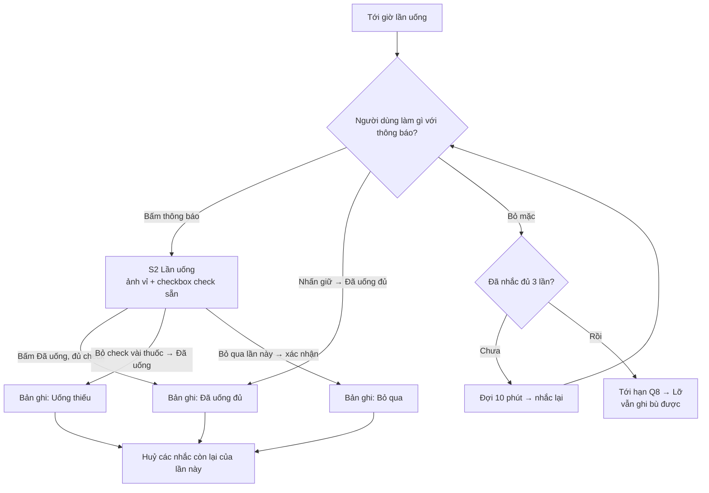
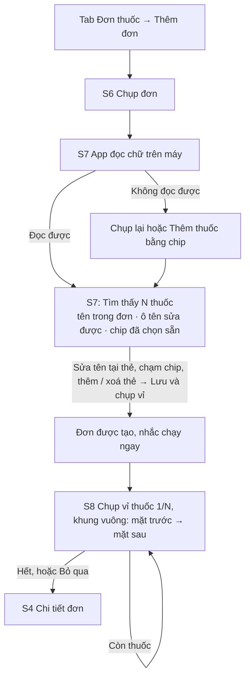

# Nhắc uống thuốc v1 · User flow (Stage 3)

Đọc cùng `PRD.md` (bản 0.2). Đây là feature đầu tiên nên chưa có mã flow cũ.

## 1. Shell và layout

- **Tab bar dưới cùng** (chuẩn iOS), 4 tab xếp theo tần suất dùng: **Hôm nay · Đơn thuốc · Lịch sử · Cài đặt**.
  Vì sao chọn tab bar:
  - Chỉ có 4 nơi đến chính, người dùng chuyển qua lại thường xuyên.
  - Thao tác bằng một tay trên iPhone.
  - Đây là pattern quen thuộc nhất của iOS.
- **Phân cấp:**
  - L0: tab.
  - L1: màn danh sách (NavigationStack, tiêu đề lớn).
  - L2: màn chi tiết được push vào, hoặc sheet.
- **Ghi nhận lần uống (S2)** mở dạng **sheet cao gần toàn màn**, không push. Lý do: mở được từ thông báo, từ Hôm nay và từ Lịch sử, xong việc là đóng về đúng chỗ cũ.
- **Chụp đơn / chụp vỉ** mở toàn màn (fullScreenCover), vì camera cần toàn màn hình.
- Hộp xác nhận (alert) chỉ dùng cho việc phá huỷ hoặc không đảo ngược được: bỏ qua lần uống, xoá đơn, xoá thuốc.
- Ba kích thước kiểm: iPhone SE (375pt), 17 (402pt), 17 Pro Max (440pt). Light + dark. Dynamic Type tới AX1.

## 2. Danh mục màn hình và trạng thái

| Mã | Màn | Kiểu | Trạng thái cần có | Hành động chính |
|---|---|---|---|---|
| O1 | Chào mừng: app giải quyết gì, trong 1 màn | Onboarding | Ready | "Bắt đầu" |
| O2 | Giờ sinh hoạt: **4 mốc** (ăn sáng, ăn trưa, ăn tối, đi ngủ), chọn bằng bánh xe giờ, có giờ gợi ý sẵn | Onboarding | Ready, giờ không hợp lệ (ví dụ ăn trưa trước ăn sáng) | "Tiếp tục" |
| O3 | Giải thích vì sao cần thông báo → hộp xin quyền của iOS | Onboarding | Ready, đã từ chối | "Bật nhắc nhở" |
| O4 | Thêm đơn đầu tiên | Onboarding | Ready | "Chụp đơn thuốc" (phụ: "Để sau") |
| S1 | **Hôm nay**: lần uống tới giờ ở đầu, rồi lần kế tiếp, các lần còn lại, các lần đã xong | Tab | Ready, Empty (chưa có đơn), Hôm nay không có thuốc, Đã xong hết ngày, Banner: chưa bật thông báo / **hỏi hết thuốc – hết đơn** / thiếu ảnh vỉ | Bấm thẻ lần uống → S2 |
| S2 | **Lần uống**: mỗi thuốc 1 dòng gồm **2 ảnh vuông mặt trước + mặt sau cạnh nhau**, tên, số lượng, cách dùng, checkbox check sẵn. Menu "…" của dòng có "Hết thuốc". | Sheet | Tới giờ, Uống sớm, Lỡ (ghi bù), Đã ghi (đang sửa), Thuốc chưa có ảnh | "Đã uống" (phụ: "Bỏ qua lần này") |
| D1 | Phóng to ảnh vỉ: **2 ảnh vuông cạnh nhau**, không vuốt. Màn quá hẹp hoặc chữ AX thì xếp trên/dưới, vẫn thấy cả hai cùng lúc. | Sheet nhỏ | Ready, Thiếu 1 hoặc 2 ảnh (ô trống có nút "Chụp") | Đóng |
| S3 | **Đơn thuốc**: danh sách đơn theo trạng thái | Tab | Ready, Empty, Có đơn sắp hết | "Thêm đơn" |
| S4 | Chi tiết đơn: đầu màn có nút **"Hết cả đơn"** nổi bật. Danh sách thuốc chia 2 nhóm "Đang dùng" / "Đã hết" (thu gọn). Mỗi thuốc đang dùng có nút **"Đã hết"** ngay trên dòng, không phải vuốt hay mở menu. Cuối màn: thông tin đơn, ảnh đơn gốc, Tạm dừng, Xoá. | Push | Ready, Đã hết (nút đầu màn đổi thành "Dùng lại đơn"), Tạm dừng, Có thuốc thiếu ảnh | "Hết cả đơn" (phụ: "Thêm thuốc") |
| S5 | Chi tiết thuốc: ảnh (2 ô vuông), tên, liều, thời điểm, lịch, ghi chú. **Mọi trường trừ tên và ghi chú là chip / bánh xe giờ.** | Push (xem) → sửa tại chỗ | Ready, Đang sửa, Đã hết, Lỗi thiếu trường | "Lưu" khi đang sửa |
| S6 | Chụp đơn: camera + chọn từ thư viện | Toàn màn | Đang ngắm, Đã chụp (xem lại), Chưa cho quyền camera | Nút chụp → "Dùng ảnh này" |
| S7 | **Danh sách thuốc đọc từ đơn.** Đầu màn: "Tìm thấy 5 loại thuốc". Mỗi thẻ thuốc có: - dòng nhỏ "Trong đơn: <tên đúng như chữ in>" - **ô tên sửa được ngay tại thẻ**, điền sẵn - chip liều, chip thời điểm, chip độ lệch đã chọn sẵn từ chữ trong đơn Cuối danh sách có "+ Thêm thuốc". | Push trong luồng | Đang đọc (Loading), Ready, Không đọc được (Error), Đọc được 0 thuốc | "Lưu và chụp vỉ" |
| S8 | Chụp vỉ từng thuốc. Đầu màn: tên thuốc (bút chì để sửa nhanh) + "Thuốc 2/5 · Mặt trước". **Khung ngắm vuông.** Bên dưới có 2 ô nhỏ trước / sau cho thấy đã chụp mặt nào. | Toàn màn | Mặt trước, Mặt sau, Xem lại ảnh, Đã xong hết | Nút chụp (phụ: "Bỏ qua thuốc này") |
| S9 | **Lịch sử**: lịch tháng, mỗi ngày một dấu | Tab | Ready, Empty (chưa có bản ghi) | Bấm ngày → S10 |
| S10 | Chi tiết ngày: các lần uống và trạng thái từng thuốc | Push | Ready, Không có thuốc ngày này | Bấm lần uống → S2 (sửa) |
| S11 | **Cài đặt**: giờ sinh hoạt, nhắc lại, kiểu báo thức, màn khoá, thông báo | Tab | Ready, Thông báo bị tắt | — |
| S12 | Sửa giờ sinh hoạt: 4 mốc chính + mốc "buổi chiều" (mặc định 15:00), kèm xem trước các lần uống sẽ dời | Push | Ready, Giờ không hợp lệ | "Lưu" |

Số khối mỗi màn ≤ 6, số trường mỗi khối ≤ 6. Riêng S5 có 6 khối: Ảnh · Tên · Liều & cách dùng · Thời điểm · Lịch · Ghi chú. Mỗi nhóm chip ≤ 6 lựa chọn; cần nhiều hơn thì chip cuối là "Khác…" mở bánh xe chọn.

## 3. Đường vào (≤ 3 bước)

| Mã | Từ đâu | Các bước | Số bước | Đạt |
|---|---|---|---|---|
| E1 | Thông báo tới giờ | Bấm thông báo → S2 của đúng lần uống đó | 1 | ✓ |
| E2 | Thông báo tới giờ, không mở app | Nhấn giữ thông báo → bấm "Đã uống đủ" | 2 | ✓ |
| E3 | Mở app từ màn hình chính | Mở app → S1, lần tới giờ ở đầu → bấm thẻ → S2 | 2 | ✓ |
| E4 | Bất kỳ đâu trong app → thêm đơn | Tab Đơn thuốc → "Thêm đơn" → S6 | 2 | ✓ |
| E5 | Bất kỳ đâu → xem lịch sử | Tab Lịch sử | 1 | ✓ |
| E6 | Bất kỳ đâu → đổi giờ sinh hoạt | Tab Cài đặt → "Giờ sinh hoạt" → S12 | 2 | ✓ |
| E7 | Banner "3 thuốc chưa có ảnh vỉ" trên S1 | Bấm banner → S8 cho các thuốc thiếu ảnh | 1 | ✓ |
| E8 | Thông báo / banner "Đơn Da liễu đủ 30 ngày. Còn uống không?" | Bấm "Hết cả đơn" ngay trên đó | 1 | ✓ |

## 4. Task (≤ 3 bước, tính từ màn bắt đầu)

| Mã | Task | Bắt đầu | Các bước | Kết quả thấy được | Số bước |
|---|---|---|---|---|---|
| T1 | Ghi nhận uống đủ | S2 | 1. Bấm "Đã uống" | Sheet đóng, thẻ lần uống trên S1 chuyển sang "Đã uống đủ ✓" | 1 |
| T2 | Ghi nhận uống thiếu | S2 | 1. Bỏ check thuốc chưa uống  2. Bấm "Đã uống" | Thẻ chuyển sang "Uống thiếu · 1 thuốc" | 2 (*mỗi thuốc thiếu thêm 1 chạm*) |
| T3 | Bỏ qua lần uống | S2 | 1. Bấm "Bỏ qua lần này"  2. Xác nhận "Bỏ qua" | Thẻ chuyển sang "Đã bỏ qua", hết nhắc | 2 |
| T4 | Tạo đơn từ ảnh | S6 | 1. Chụp  2. Bấm "Dùng ảnh này" → S7 tự đọc  3. Bấm "Lưu danh sách" | Đơn mới trong S3, chuyển sang S8 | 3 (*sửa dòng nào thì cộng thêm bước sửa dòng đó*) |
| T5 | Chụp vỉ cho 1 thuốc | S8 | 1. Chụp mặt trước  2. Chụp mặt sau | Tự chuyển sang thuốc kế tiếp, hoặc "Xong" | 2 |
| T6 | Đổi giờ sinh hoạt | S12 | 1. Chỉnh giờ (xem trước tự cập nhật)  2. Bấm "Lưu" | Toast "Đã dời 2 lần uống", S1 đổi giờ | 2 |
| T7 | Sửa lần đã ghi trong hôm nay | S1 | 1. Bấm thẻ đã xong → S2  2. Đổi check  3. Bấm "Lưu thay đổi" | Thẻ cập nhật trạng thái | 3 |
| T8 | Xem một ngày cũ | S9 | 1. Bấm ngày | S10 | 1 |
| T9 | Tạm dừng một đơn | S4 | 1. Bấm "Tạm dừng"  2. Xác nhận | Đơn hiện nhãn "Tạm dừng", thuốc biến khỏi các lần uống | 2 |
| T10 | Thêm thuốc bằng tay vào đơn | S4 | 1. Bấm "Thêm thuốc"  2. Gõ tên + chạm chip (chip đã chọn sẵn mặc định)  3. Bấm "Lưu" | Thuốc mới trong S4, các lần uống cập nhật | 3 |
| T11 | Đánh dấu 1 thuốc đã hết, ngay lúc đang uống | S2 | 1. Bấm "…" trên dòng thuốc  2. Bấm "Hết thuốc" | Dòng biến mất khỏi lần uống này và các lần sau, toast "Đã đánh dấu hết · Hoàn tác" | 2 |
| T12 | Đánh dấu 1 thuốc đã hết, từ chi tiết đơn | S4 | 1. Bấm "Đã hết" trên dòng thuốc | Thuốc chuyển xuống nhóm "Đã hết", toast có Hoàn tác | 1 |
| T13 | Hết cả đơn | S4 | 1. Bấm "Hết cả đơn"  2. Xác nhận | Đơn sang "Đã hết", mọi thuốc của đơn rời các lần uống, huỷ thông báo | 2 |
| T14 | Trả lời câu hỏi "đã hết chưa" của app | Banner S1 hoặc thông báo | 1. Bấm "Hết rồi" / "Vẫn còn" | Như T12/T13, hoặc banner biến mất 7 ngày | 1 |
| T15 | Đổi "trước ăn 30 phút" thành 15 phút | S5 hoặc S7 | 1. Chạm chip "15 phút" (+ "Lưu" nếu ở S5) | Giờ của lần uống cập nhật ngay trong xem trước | 1–2 |

**Ngoại lệ chờ duyệt (X1):** việc *nhập trọn một đơn* (T4 + N lần T5) dài hơn 3 bước vì có N thuốc.
- Cách xử lý: tách thành các task con, mỗi task ≤ 3 bước.
- Dừng được ở bất kỳ thuốc nào. Đơn vẫn chạy nhắc ngay sau T4, kể cả khi chưa có ảnh.
- Phần còn dở hiện ở banner E7.
- Việc này chỉ làm 1 lần cho mỗi đơn.

## 5. Luồng chính

### A01. Onboarding (lần đầu mở app)
1. O1 Chào mừng: một câu "Tới giờ, app nhắc bạn uống viên nào, kèm ảnh vỉ thuốc". Bấm "Bắt đầu".
2. O2 Giờ sinh hoạt: 4 mốc (ăn sáng, ăn trưa, ăn tối, đi ngủ) có giờ gợi ý sẵn (Q21). Bấm "Tiếp tục".
3. O3 Giải thích thông báo → hộp xin quyền của iOS.
4. O4 "Chụp đơn thuốc" → luồng thêm đơn. Hoặc "Để sau" → S1 trạng thái Empty.

### A02. Một ngày dùng app (kịch bản painpoint, dữ liệu hư cấu)
Giờ sinh hoạt: ăn sáng 7:00, ăn trưa 12:00, ăn tối 19:00, ngủ 23:00. Buổi chiều dùng mặc định 15:00.

| Lần uống | Giờ | Thuốc (hư cấu) |
|---|---|---|
| Sáng · trước ăn | 6:30 | Thuốc A (da liễu) 1 viên. Đơn ghi "trước ăn sáng", không ghi phút, nên dùng mặc định 30 phút. |
| Sáng · sau ăn | 7:15 | Thuốc B (da liễu) 2 viên · Vitamin C (bổ) 1 viên · Kẽm (bổ) 1 viên, **cách ngày** |
| Chiều | 15:00 | Thuốc C (da liễu) 1 viên |
| Tối · sau ăn | 19:15 | Thuốc B (da liễu) 2 viên · Omega-3 (bổ) 1 viên |
| Trước ngủ | 22:00 | Thuốc D (da liễu) ½ viên |

Ngày không uống kẽm thì lần "Sáng · sau ăn" chỉ còn 2 thuốc. Số lần uống trong ngày vẫn là 5.

### A03. Hết thuốc (người dùng hay quên báo)
Vì người dùng thường không tự báo thuốc đã hết, app có 3 lớp, lớp sau đỡ cho lớp trước:
1. **Lúc đang uống (S2):** thấy hết vỉ thì bấm "…" → "Hết thuốc" ngay trên dòng thuốc (T11).
2. **Lúc xem đơn (S4):** nút "Đã hết" ngay trên từng dòng (T12) và "Hết cả đơn" ở đầu màn (T13).
3. **App tự hỏi (T14):**
   - một thuốc bị bỏ check 3 lần liên tiếp (Q24), hoặc
   - đơn đủ số ngày dùng (Q10).
   Câu hỏi hiện trên banner Hôm nay; riêng đơn đủ ngày thì có thêm thông báo. Trả lời 1 chạm.

Mọi lần đánh dấu hết đều có "Hoàn tác" trong toast, và "Dùng lại" trong nhóm "Đã hết" của S4.
